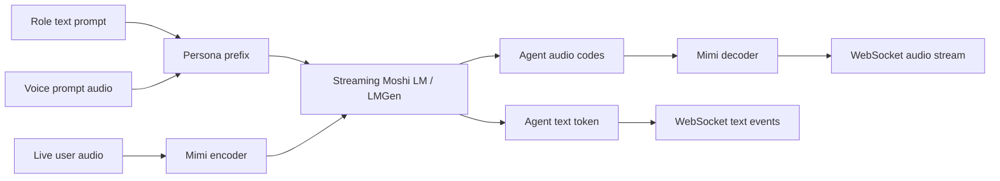

# PersonaPlex architecture and inference code path

## Model at a glance

PersonaPlex is Moshi-based. The core is a streaming, frame-synchronous speech
model. PersonaPlex conditioning adds a role prompt encoded as text and a voice
prompt encoded as audio tokens; these become a prefix to the existing streams.
The backbone still performs joint speech understanding and speech generation.

The current architecture notes in
[`../../docs/optimize_personaPlex/personaplex_moshi_architecture.md`](../../docs/optimize_personaPlex/personaplex_moshi_architecture.md)
describe the streams and prompt prefix in more detail. Verify tensor shapes,
delays, and exact module names against the pinned source once it is cloned.

## Inference path to trace in source

1. `moshi.server.main()` parses runtime flags, resolves checkpoint/config files,
   loads Mimi, tokenizer, Moshi LM and voice prompts, then builds `ServerState`
   and warms the streaming modules.
2. `/api/chat` accepts a WebSocket session. The session loads the requested
   voice prompt and encodes the role prompt into system-prompt tokens.
3. The receive loop accepts binary Opus packets. The Opus reader decodes PCM;
   the server buffers PCM until a Mimi frame is available.
4. Mimi encodes user audio into audio codes. `LMGen.step()` advances the
   autoregressive streaming state and returns the text/audio token frame.
5. Mimi decodes generated agent audio codes. The server sends audio and text
   events back over the same WebSocket.
6. Session cleanup/reset clears streaming state. In the current upstream server
   implementation, one shared state lock serializes access to the model state;
   account for this when measuring concurrent sessions.

## Source reading map

| File/module | Why read it |
|---|---|
| `moshi/server.py` | Serving entrypoint, prompt setup, frame loop, WebSocket protocol, session state |
| `moshi/offline.py` | WAV-based deterministic/offline path; likely starting point for scenario rollouts |
| `moshi/models/loaders.py` | Checkpoint/config loading and model construction |
| `moshi/models/lm.py` | Moshi LM, streaming generation, text/audio heads, state/cache behavior |
| `moshi/modules/transformer.py` | Transformer blocks and likely LoRA insertion points |
| `moshi/modules/streaming.py` | Streaming cache/state lifecycle |
| `moshi/client_utils.py`, `client/` | Input/output protocol and voice/role prompt wiring |

The Modal adapter only launches the server process. The actual model and
frame-by-frame inference logic lives in this upstream package.

## Research seams to confirm after source clone

- **Rollout seam:** replay a fixed stereo/audio scenario and capture text,
  generated audio, timestamps, seed, and model configuration.
- **Policy/reward seam:** score a completed rollout from explicit scenario
  labels and decoded output; keep the verifier independent of training code.
- **Training seam:** identify whether generation log-probabilities and
  gradients can be obtained through the streaming path. Confirm how to preserve
  audio/text delay and recurrent state when computing GRPO updates.
- **Baseline seam:** run the same scenarios and seeds through the unmodified
  checkpoint before adding LoRA or controller behavior.

Do not infer that a classifier or reward can change generated speech until its
action is connected to an execution path and the resulting audio is evaluated.
