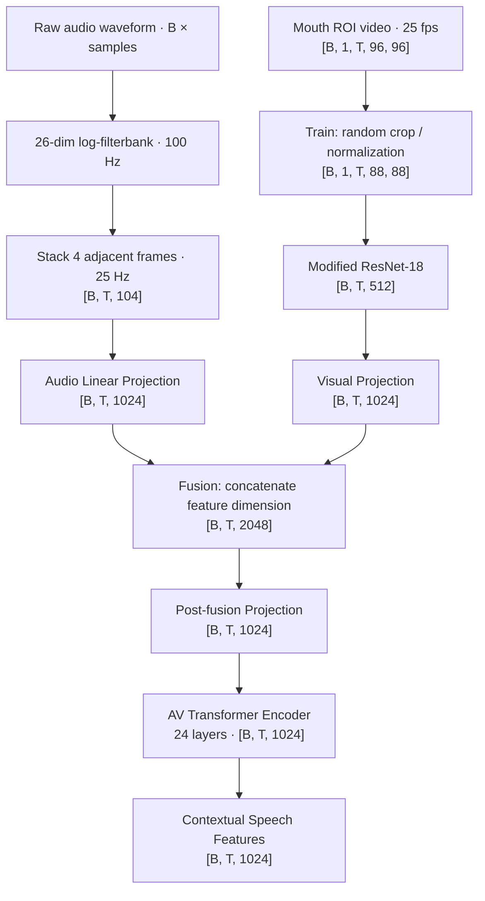
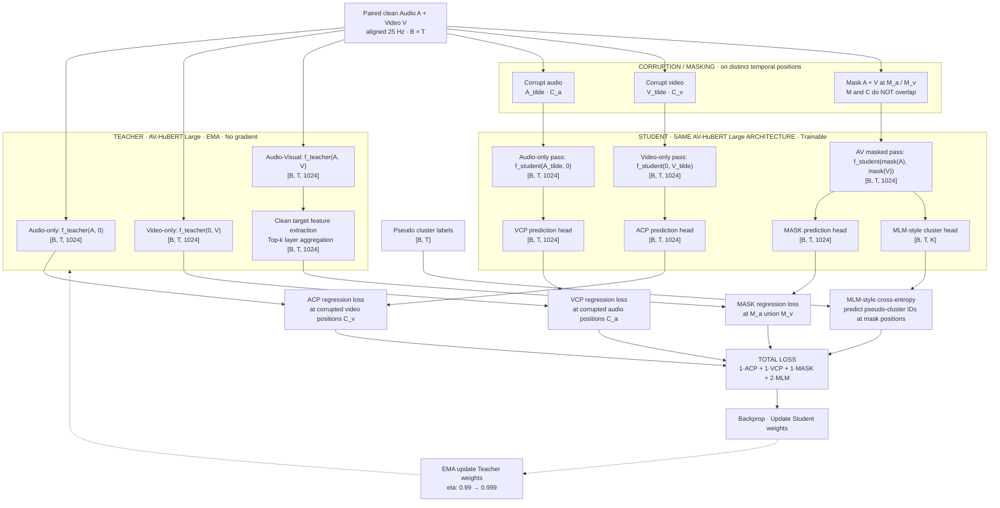
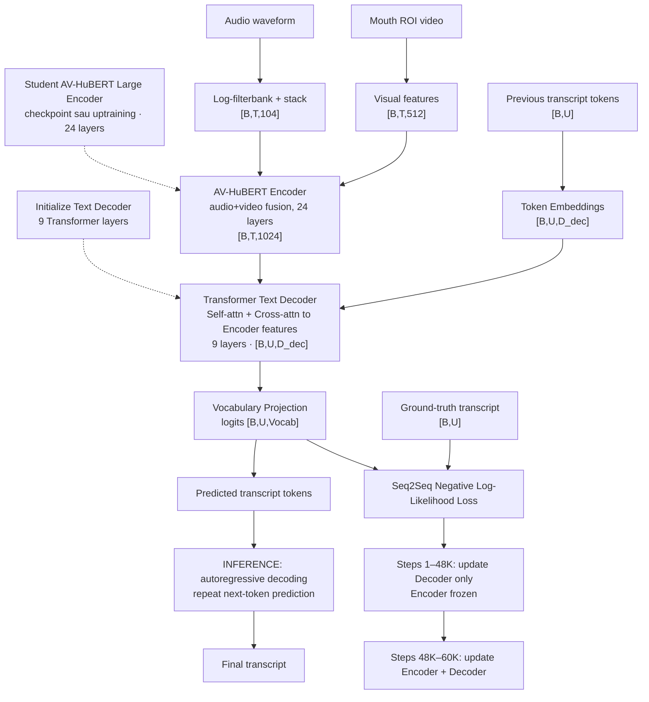

# CAV2vec — Research Report (ICLR 2025)

> **Paper:** *Multi-Task Corrupted Prediction for Learning Robust Audio-Visual Speech Representation*  
> **Authors:** Sungnyun Kim, Sungwoo Cho, Sangmin Bae, Kangwook Jang, Se-Young Yun  
> **Venue:** ICLR 2025 · **Direction:** Robust AVSR / Self-supervised Representation Learning  
> **Paper:** https://arxiv.org/html/2504.18539  
> **GitHub:** https://github.com/sungnyun/cav2vec  
> **Các phần đối chiếu:** Paper §3–5, Appendix A.2; Figure 3 (uptraining), Figure 5 (ablation).

**Một câu tóm tắt:** CAV2vec lấy **AV-HuBERT Large Encoder pretrained** làm nền, tiếp tục **uptraining Teacher–Student** để Encoder tạo đặc trưng bền vững trước nhiễu/che khuất; sau đó **fine-tune Encoder + Text Decoder** với transcript thật để nhận dạng lời nói.

---

## 1. Overview & Problem

**Problem:** AVSR kết hợp âm thanh và chuyển động môi để nhận dạng tiếng nói, nhưng trong môi trường thật **cả audio lẫn video có thể suy giảm đồng thời**: tiếng ồn, tiếng nói nền, vật thể che miệng, làm mờ hoặc giảm chất lượng ảnh. Nhiễu làm các biểu diễn đặc trưng lệch khỏi nhau, khiến việc kết hợp hai modality kém tin cậy và WER tăng.

**Câu hỏi nghiên cứu:** Làm sao huấn luyện **biểu diễn Audio–Video robust** để khi một nguồn bị nhiễu, đặc trưng từ nguồn còn lại vẫn mang thông tin hỗ trợ nhận dạng?

**Đóng góp trọng tâm:** Thay vì chỉ dùng audio + video nhiễu để dự đoán **đặc trưng Audio–Video sạch**, CAV2vec còn dùng hai nhiệm vụ **học chéo một modality → modality kia**: **ACP** và **VCP**.

**Phân biệt:** CAV2vec **không** đề xuất một LLM decoder mới, **không** tạo lại waveform/frame sạch và **không** phải phương pháp decoding training-free như GCD.

## 2. Input / Output & Method

| Giai đoạn | Input | Target / Output | Phần được học |
|---|---|---|---|
| **Uptraining** (không cần transcript) | Audio/Video gốc và các bản **corrupted/masked** | Student dự đoán **clean feature targets** của Teacher; đồng thời dự đoán pseudo-label cluster ở vị trí mask | Chủ yếu **Student Encoder** và các predictor/head phụ trợ; Teacher cập nhật EMA |
| **Fine-tuning** (có transcript) | Audio + Video có nhiễu tăng cường và **ground-truth transcript** | **Token transcript**; supervised sequence-to-sequence NLL loss | **Decoder trước**, sau đó **Encoder + Decoder** |
| **Inference** | Audio + Video | **Transcript** | Không cập nhật tham số; **không dùng Teacher/loss/uptraining heads** |

**Method, nói ngắn gọn:**

1. Khởi tạo hai bản **AV-HuBERT Large Encoder** giống kiến trúc: **Student** (cập nhật gradient) và **Teacher** (cập nhật EMA).
2. Teacher xử lý đầu vào **sạch**, tạo **đặc trưng đích**; Student xử lý đầu vào **bị corruption hoặc mask**.
3. Tính **ACP, VCP, Masked Prediction, MLM-style loss**; backprop cập nhật Student; EMA cập nhật Teacher.
4. Giữ Encoder Student đã học, gắn **9-layer Transformer Text Decoder** để fine-tune trên transcript có nhãn.
5. Inference chỉ dùng **AV-HuBERT Encoder + Text Decoder** đã fine-tune.

### Quy ước tensor shape

| Ký hiệu | Ý nghĩa |
|---|---|
| `B` | Batch size |
| `T` | Số thời điểm sau khi đưa audio và video về **25 Hz** |
| `D=1024` | Hidden size của **AV-HuBERT Large Encoder** |
| `U` | Số token transcript trong quá trình fine-tune/decoding |
| `D_dec` | Hidden size của Text Decoder, phụ thuộc config/checkpoint |
| `Vocab` | Số token trong từ điển của Text Decoder |
| `K` | Số nhãn cluster (pseudo-label) dùng cho MLM-style objective |
| `C_a`, `C_v` | Các vị trí audio hoặc video bị **corruption** |
| `M_a`, `M_v` | Các vị trí audio hoặc video bị **mask** |

**Ví dụ xuyên suốt:** một clip **2 giây** có `B=1`, `T≈50`. Các shape `[1,50,…]` chỉ minh họa; thời lượng clip và padding thực tế làm `T` thay đổi. Mục **3–5** dùng shape theo cấu hình AV-HuBERT Large; những kích thước không cố định được giữ bằng ký hiệu, không đoán số.

---

## 3. Backbone Architecture — AV-HuBERT Large

**Backbone:** AV-HuBERT Large pretrained (noise-augmented), **24 Transformer Encoder layers**. Nhánh audio là projection của log-filterbank; nhánh video là **modified ResNet-18**. Encoder này được dùng cho **cả Teacher và Student**, với **hai bộ trọng số** trong uptraining.

### Sơ đồ 1 — Bên trong một Encoder



> **Đọc shape:** `T` là **độ dài chuỗi theo thời gian**, `1024` là **số chiều mỗi vector**. Concatenate nối **chiều đặc trưng** (`1024 + 1024 = 2048`), không nối thành `2T`. Linear/projection đưa về kích thước Transformer. Dòng video được biểu diễn dưới dạng `[B,1,T,H,W]` theo quy ước tensor của video pipeline; nếu đọc dữ liệu trước phép `permute`, thứ tự chiều có thể khác.
>
> **Lưu ý kiểm chứng:** `Audio 104 → 1024`, video backend `512 → 1024` và fusion `2048 → 1024` là cách diễn đạt cho cấu hình Large dùng concat-fusion; thứ tự conv/linear/normalization trong code có thể được đóng gói trong các module phụ. Sơ đồ mô tả luồng tensor ở **mức block**, không phải từng phép toán nội bộ.

| Block | Input → Output (minh họa) | Chức năng |
|---|---|---|
| Log-filterbank + stack | Waveform → `[1,50,104]` | 26 đặc trưng × 4 frame ghép lại để đồng bộ nhịp 25 Hz với video |
| Audio projection | `[1,50,104] → [1,50,1024]` | Đưa đặc trưng âm thanh về hidden size của Encoder |
| Mouth ROI + ResNet-18 | `[1,1,50,88,88] → [1,50,512]` | Trích đặc trưng hình học/chuyển động vùng miệng |
| Visual projection | `[1,50,512] → [1,50,1024]` | Đưa video về cùng kích thước biểu diễn với audio |
| Concat + post-projection | Hai tensor `[1,50,1024]` → `[1,50,2048]` → `[1,50,1024]` | Kết hợp audio/video tại **cùng thời điểm** rồi chuẩn hóa kích thước cho Transformer |
| 24 Transformer Encoder blocks | `[1,50,1024] → [1,50,1024]` | Self-attention học ngữ cảnh thời gian; output có cùng shape tổng thể |

**Chế độ một modality:** Với ACP/VCP, một nhánh input bị bỏ (**modality dropout/zero input**) nhưng **vẫn dùng cùng Encoder**. Ví dụ `f(A,0)` cho audio-only và `f(0,V)` cho video-only; không phải Teacher Audio và Teacher Video là hai backbone độc lập.

---

## 4. CAV2vec Uptraining — Full Teacher–Student Method

### 4.1. Sơ đồ 2 — Toàn bộ luồng học



**Cách đọc sơ đồ:** Có **hai bản encoder** (Teacher và Student). Trong mỗi bản, các nhãn `audio-only`, `video-only` và `audio+video` là **các lần forward / cấu hình input của cùng kiến trúc**, không phải 3 mạng được huấn luyện độc lập. Trong paper, các nhiệm vụ tương ứng được tổ chức với **modality dropout**.

### 4.2. Giải thích từng block trong uptraining

| Block | Input | Xử lý | Output / ý nghĩa |
|---|---|---|---|
| **Clean paired sample** | Audio và video cùng thời gian | Đồng bộ tại 25 Hz | `A`, `V` sạch; **không cần transcript** |
| **Corruption** | `A`, `V` | Audio: babble/music/speech/natural noise; video: che vùng miệng, blur, Gaussian noise | `A_tilde` / `V_tilde` bị nhiễu; ghi lại vị trí `C_a`, `C_v` |
| **Masking** | Đặc trưng có thể đã qua corruption | Che một số **vị trí không trùng** với corrupted positions | `M_a`, `M_v` để học ngữ cảnh bằng masked prediction |
| **Teacher** | Audio-only, video-only hoặc audio+video sạch | Chạy AV-HuBERT Large, trích feature target (có aggregation top-k lớp) | Các tensor `[B,T,1024]` làm mục tiêu học; **không có backprop** |
| **Student** | Video-only bị nhiễu, audio-only bị nhiễu hoặc AV bị mask | Chạy **cùng kiểu Encoder** với trọng số có thể cập nhật | Các feature `[B,T,1024]` cần học cho đúng |
| **Prediction head** | Student features `[B,T,1024]` | MLP/predictor phụ trợ theo task | Đưa output về không gian feature target của Teacher |
| **Losses** | Student prediction + Teacher target / pseudo-label | Regression (feature matching) hoặc CE (cluster classification) | Một giá trị loss cho mỗi task |
| **Student update** | Tổng loss | Backpropagation, optimizer | Cập nhật trọng số Student + heads |
| **Teacher EMA** | Teacher weights cũ + Student weights mới | Moving average, không gradient | Teacher target thay đổi từ từ theo Student |

### 4.3. Hai nhiệm vụ **học chéo** (innovation chính)

**ACP — Audio Corrupted Prediction:**

```text
Teacher: Audio SẠCH  → f_teacher(A,0)       → clean AUDIO target   [B,T,1024]
Student: Video NHIỄU → f_student(0,V_tilde) → predicted features   [B,T,1024]
                                        ↓ so sánh tại vị trí C_v
                                      L_ACP
```

- **Tại sao học chéo?** Student chỉ thấy video (đôi khi bị che) nhưng được yêu cầu tạo biểu diễn gần **audio sạch**. Vì vậy, nó phải học quan hệ giữa chuyển động môi và thông tin tiếng nói.
- **Tính loss ở đâu?** Chỉ tại các thời điểm **video bị corruption** `C_v`, không mặc định trên mọi frame.

**VCP — Visual Corrupted Prediction:**

```text
Teacher: Video SẠCH → f_teacher(0,V)         → clean VIDEO target   [B,T,1024]
Student: Audio NHIỄU → f_student(A_tilde,0) → predicted features   [B,T,1024]
                                        ↓ so sánh tại vị trí C_a
                                      L_VCP
```

- Student dùng **audio nhiễu** để học đặc trưng gần với **video sạch**. Tính loss tại các thời điểm `C_a`.
- **Cả ACP và VCP dự đoán vector đặc trưng**, không sinh audio waveform, frame ảnh hay transcript.

### 4.4. Hai nhiệm vụ hỗ trợ khác

**Masked Prediction (`L_MASK`):** Student nhận **cả audio+video**, với một số vị trí bị mask; so sánh feature Student tại `M_a ∪ M_v` với feature từ **Teacher audio+video sạch**. Mục đích: học ngữ cảnh và thông tin tích hợp từ cả hai modality.

**MLM-style loss (`L_MLM`):** Từ output Student, head phân loại dự đoán **ID của cluster/pseudo-label** tại vị trí bị mask. Shape logits **`[B,T,K]`**, label **`[B,T]`**. Đây **không phải** bài toán dự đoán transcript tiếng Anh và **không phải** Text Decoder.

**Tổng loss (Eq. 5):**

\[
L = L_{ACP} + L_{VCP} + L_{MASK} + 2L_{MLM}
\]

- `L_ACP`, `L_VCP`, `L_MASK`: feature regression, thường diễn giải là MSE/feature-matching.
- `L_MLM`: cross-entropy của pseudo-cluster ID.
- **Điều kiện:** ` (M_a ∪ M_v) ∩ (C_a ∪ C_v) = ∅ ` — vị trí dùng cho masking và corruption **không chồng nhau**.
- **Cập nhật:** Student bằng backprop; Teacher bằng `θ_T ← η θ_T + (1−η) θ_S`, với EMA `η` tăng từ `0.99` lên `0.999`.

**Thông số uptraining từ paper:** AV-HuBERT Large pretrained → tiếp tục huấn luyện **60K steps**, sử dụng 4×RTX A6000 (tác giả báo cáo khoảng **8–10 giờ** cho uptraining, không bao gồm pretraining backbone gốc). Audio corruption có các chế độ noise augmentation; visual corruption áp dụng lên 10–50% độ dài; audio corruption cục bộ khoảng 30–50%; chi tiết trong Appendix A.2. Những tỷ lệ mask cao trong cấu hình là **xác suất đặt mask trước khi loại trừ vùng corruption**, không phải lượng frame mask cuối cùng.

**Điểm cần nhớ:** **ACP + VCP** có *unimodal input* nhưng *cross-modal target*; **MASK** có *multimodal input* và *multimodal target*. Đó là sự khác biệt cốt lõi giữa các nhiệm vụ.

---

## 5. Supervised Fine-tuning & Inference

Sau uptraining, ta **lấy Student Encoder**, **bỏ Teacher, EMA và predictor heads**, rồi bổ sung **9-layer Transformer Text Decoder**. Đây không phải một backbone mới: AV-HuBERT Large tiếp tục làm Encoder.

### Sơ đồ 3 — Fine-tuning và inference



> Sơ đồ trên vừa thể hiện **training path** (loss + update), vừa thể hiện **inference path** (sinh token). Trong inference **không có ground-truth transcript**; mỗi token được sinh ra sẽ trở thành ngữ cảnh cho bước kế tiếp. `D_dec`, `U`, `Vocab` được ghi dạng biến vì số cụ thể phụ thuộc config/tokenizer của checkpoint.

### Fine-tuning: Train chính xác những phần nào?

| Giai đoạn | Encoder 24 layers | Text Decoder 9 layers | Learning target |
|---|---|---|---|
| **48.000 steps đầu** | **Frozen** | **Train** | Ground-truth transcript (sequence-to-sequence NLL) |
| **12.000 steps tiếp** | **Train / Unfreeze** | **Train** | Ground-truth transcript (cùng loss) |
| **Inference** | Eval only | Eval only | Không có loss, không update |

**Luồng một batch fine-tuning, theo thứ tự:**

1. Cho audio + video qua **Encoder Student đã uptraining** để ra `[B,T,1024]`.
2. Cho **token transcript trước đó** (teacher forcing khi train) vào Text Decoder.
3. Text Decoder dùng **self-attention** trên token text và **cross-attention** tới Encoder features để dự đoán token kế tiếp.
4. So sánh logits `[B,U,Vocab]` với **ground-truth token IDs** `[B,U]` bằng **sequence-to-sequence negative log-likelihood / cross-entropy**.
5. Cập nhật **chỉ decoder** giai đoạn đầu; **cập nhật cả encoder + decoder** giai đoạn sau. Paper **không sử dụng CTC loss** ở fine-tuning này.

**Fine-tuning vẫn có corruption augmentation** để học đúng nhiệm vụ AVSR trong môi trường suy giảm; không phải chỉ huấn luyện audio/video sạch. Theo paper, visual corruption giống giai đoạn uptraining; một phần audio được thêm nhiễu theo SNR lấy mẫu.

**Luồng inference cuối cùng:**

```text
Audio + Video → Feature Extractors → AV-HuBERT Encoder [B,T,1024]
              → Text Decoder (9 layers) → Token scores
              → Chọn token tiếp theo → Lặp đến khi kết thúc
              → Transcript
```

**Không còn Teacher, EMA, các loss ACP/VCP/MASK/MLM, predictor heads hoặc ground-truth transcript ở inference.**

---

## 6. Results & Contributions

### Thực nghiệm chính

- **Dataset:** LRS3 (~433 giờ) và LRS2 (~224 giờ), cùng các bộ nhiễu/occlusion. Đánh giá chất lượng bằng **WER** (*word error rate*, càng thấp càng tốt).
- **Audio corruption:** babble, speech, music, natural; và nhiễu **DEMAND** chưa gặp trong training để đánh giá khả năng tổng quát.
- **Video corruption:** vật thể che miệng, Gaussian noise/blur; kiểm tra thêm **tay che miệng** và **pixelation** chưa gặp trong uptraining.

| Kết quả tiêu biểu | AV-data2vec | AV-RelScore | **CAV2vec** |
|---|---:|---:|---:|
| **LRS3** · Audio noise + object occlusion/visual noise · average N-WER (%) | 6.2 | 5.9 | **5.1** |

Đây là **average N-WER ở một cấu hình đánh giá cụ thể**, **không phải WER tổng quát cho mọi tập dữ liệu**. Với LRS2 trong Table 3, CAV2vec đạt WER thấp hơn AV-HuBERT ở cả bốn nhóm nhiễu được báo cáo và trên clean data.

### Đóng góp

1. **Representation robustness:** dự đoán đặc trưng sạch từ đầu vào bị nhiễu, không cần reconstruct waveform/frame.
2. **Cross-modal alignment:** ACP và VCP buộc model học mối liên hệ **Video → Audio feature** và **Audio → Video feature** qua mục tiêu học chéo.
3. **Không thay đổi backbone chính:** dùng cùng AV-HuBERT Large; các prediction head phụ được bỏ sau uptraining.
4. **Cải thiện WER trước corruption**, kể cả một số loại visual corruption và environmental noise chưa từng gặp trong uptraining.

### Hạn chế / đánh đổi

- **Không training-free:** cần thêm **uptraining** và **supervised fine-tuning**. Đòi hỏi GPU, dữ liệu video đã đồng bộ và augmentation pipeline.
- Chất lượng phụ thuộc **checkpoint AV-HuBERT pretrained**, dữ liệu và chế độ nhiễu đã thiết kế; không mặc định tổng quát sang mọi loại corruption.
- Các kết quả WER là từ thiết lập trong paper, không thể so sánh trực tiếp với MoHAVE/GCD nếu khác backbone, dữ liệu và điều kiện đánh giá.

**Takeaway:** Điểm mới thực chất của CAV2vec nằm ở **cách uptrain Encoder bằng các loss chéo ACP/VCP**, còn **fine-tuning dùng Text Decoder để học tạo transcript có nhãn**. Khi chạy thực tế, chỉ còn **Encoder đã học + Decoder**, không còn Teacher.

---

## Nguồn đối chiếu

1. **Paper chính thức:** [arXiv HTML — Sections 3–5, Appendix A.2](https://arxiv.org/html/2504.18539)
2. **Paper hội nghị:** [ICLR 2025 proceedings PDF](https://proceedings.iclr.cc/paper_files/paper/2025/file/a452a7c6c463e4ae8fbdc614c6e983e6-Paper-Conference.pdf)
3. **Code tác giả:** [sungnyun/cav2vec](https://github.com/sungnyun/cav2vec)
4. **Backbone gốc:** [facebookresearch/av_hubert](https://github.com/facebookresearch/av_hubert)

*Định dạng: Markdown chuẩn + 3 sơ đồ Mermaid. GitHub hỗ trợ render Mermaid trực tiếp; với Notion, có thể dùng Mermaid code block hoặc xuất thành hình nếu workspace chưa hỗ trợ render.*
