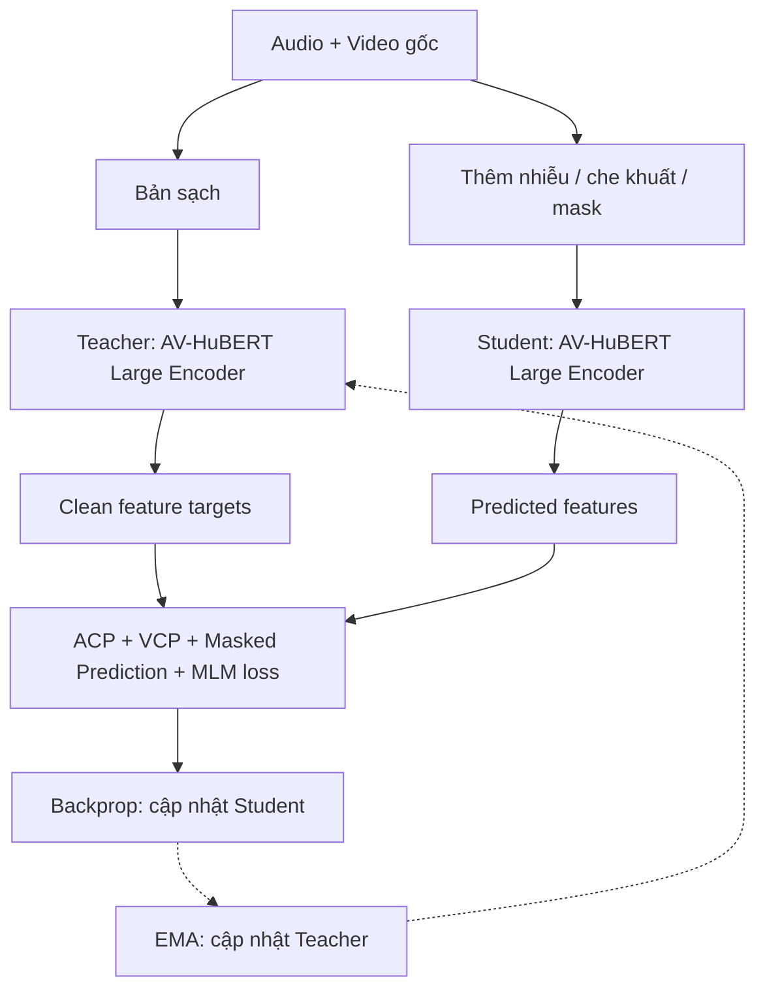
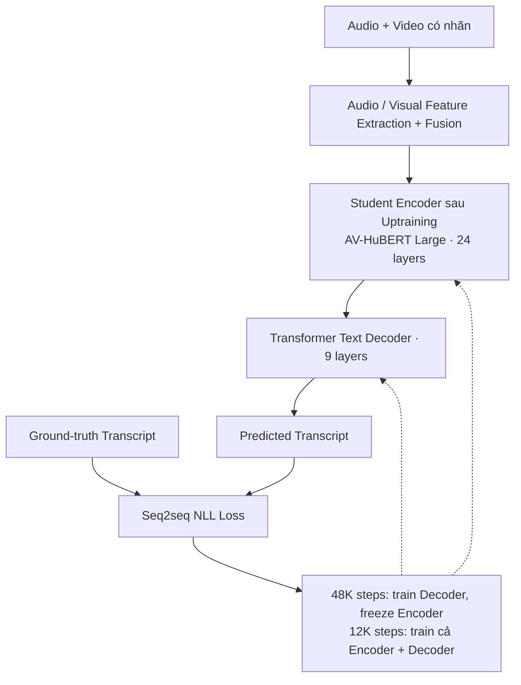

# CAV2vec — Short Research Report

**Paper:** *Multi-Task Corrupted Prediction for Learning Robust Audio-Visual Speech Representation*  
**Venue:** ICLR 2025 · **Hướng:** Robust AVSR / Representation Learning  
**Backbone:** Noise-augmented **AV-HuBERT Large** (Encoder 24 Transformer layers; Text Decoder 9 layers sau fine-tuning).  
**Nguồn:** [Paper](https://arxiv.org/html/2504.18539) · [GitHub](https://github.com/sungnyun/cav2vec)

## 1. Input

- **Uptraining:** Audio + video sạch để Teacher tạo *feature targets*; audio/video bị nhiễu, che hoặc mask để Student học dự đoán.
- **Fine-tuning:** Audio + video kèm transcript thật (nhãn).
- **Inference:** Audio + video của người nói.

## 2. Output

- **Uptraining:** Encoder (Student) học được **đặc trưng Audio–Video chống nhiễu**; chưa tạo transcript.
- **Fine-tuning:** Mô hình AVSR đã được huấn luyện để nhận dạng lời nói.
- **Inference:** **Transcript** — văn bản lời nói được nhận dạng.

## 3. Problem

AVSR dễ nhận dạng sai khi **cả âm thanh lẫn hình ảnh vùng miệng bị suy giảm** (tiếng ồn, che môi, video mờ). Chỉ bổ sung dữ liệu nhiễu khi fine-tune chưa đủ để Encoder học được biểu diễn ổn định trong những tình huống khó.

## 4. Method & Architecture

**Ý tưởng:** Lấy AV-HuBERT Large pretrained, **uptrain Encoder bằng Teacher–Student self-distillation**; sau đó **fine-tune Encoder + Text Decoder** với transcript thật. Điểm mới nằm chủ yếu ở cách học *representation*, không phải ở Decoder mới.

### Sơ đồ 1 — CAV2vec Uptraining (học Encoder)

**Các block chính:**

- **Teacher:** Nhận dữ liệu sạch (ở chế độ audio-only, video-only hoặc audio-video), xuất vector đặc trưng làm *target*; không nhận gradient trực tiếp.
- **Student:** Nhận đầu vào đã bị corruption/masking, dự đoán đặc trưng; trọng số được cập nhật bằng backpropagation.
- **ACP:** **Video nhiễu → dự đoán audio features sạch** của Teacher.
- **VCP:** **Audio nhiễu → dự đoán video features sạch** của Teacher.
- **Masked Prediction:** Dùng Audio + Video có mask để dự đoán **audio-visual features sạch** ở vị trí mask.
- **MLM:** Dự đoán nhãn cluster tại vị trí mask (một loss hỗ trợ).
- **EMA:** Cập nhật Teacher theo trung bình trượt của trọng số Student. Các *prediction heads* phục vụ uptraining sẽ được bỏ đi sau giai đoạn này.

> **Lưu ý:** Sơ đồ gộp nhiều chế độ đầu vào của **cùng một Teacher và cùng một Student**, không phải các mô hình độc lập. Ở ACP Student dùng **video-only**; ở VCP Student dùng **audio-only**; còn masked prediction dùng **cả hai**.

### Sơ đồ 2 — Fine-tuning & Inference (học transcript)

**Các block chính:**

- **Feature Extraction + Fusion:** Audio qua linear projection; video vùng miệng qua modified ResNet-18; ghép đặc trưng rồi đưa vào Encoder.
- **Encoder (24 layers):** **Chính là Student Encoder sau uptraining**, đã học biểu diễn chống nhiễu.
- **Decoder (9 layers):** Nhận Encoder features và các token văn bản trước đó để dự đoán token tiếp theo.
- **Seq2seq Loss:** So sánh token dự đoán với transcript thật; **48K bước đầu chỉ cập nhật Decoder**, **12K bước sau cập nhật cả hai**.
- **Inference:** Chạy luồng **Audio + Video → Feature Extraction/Fusion → Encoder → Decoder → Transcript**, **không dùng Teacher, EMA hoặc Loss**.

**Kết luận một câu:** CAV2vec **uptrain Encoder để học đặc trưng robust**, rồi **fine-tune Encoder–Decoder để chuyển đặc trưng thành transcript**.

---
**Ghi chú:** Hai sơ đồ là bản **tối giản phục vụ trình bày**, không phải hình được sao chép nguyên dạng từ paper. Chi tiết gốc: Section 4 (Figure 3), Section 5.1 và Appendix A.2.
