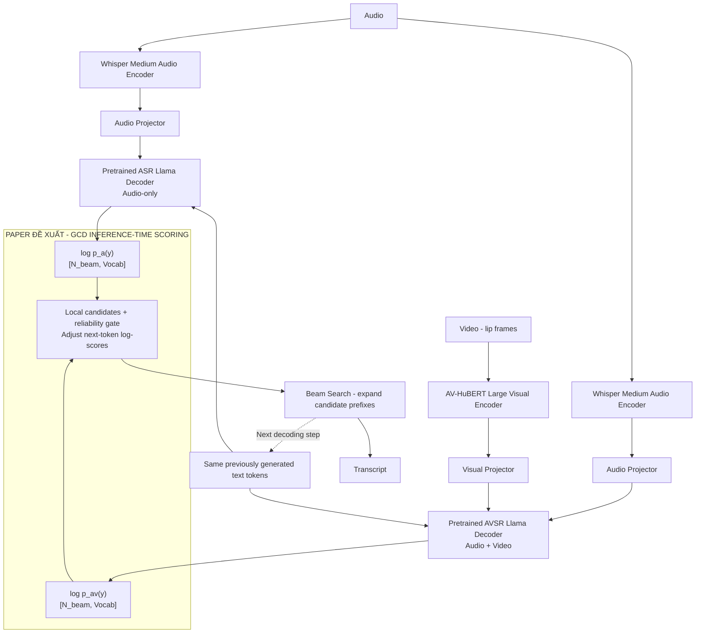
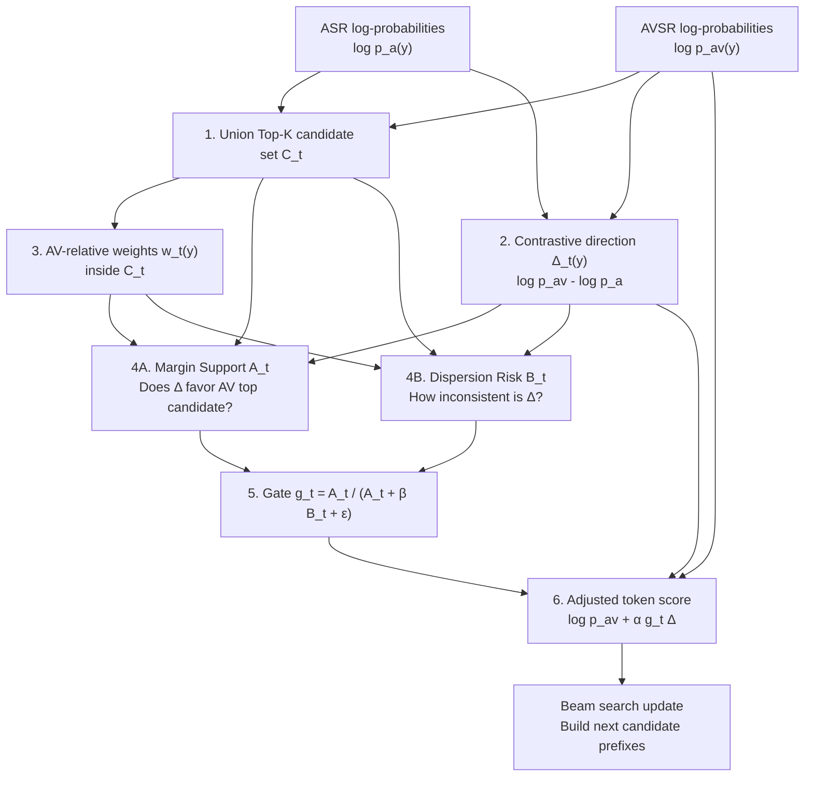
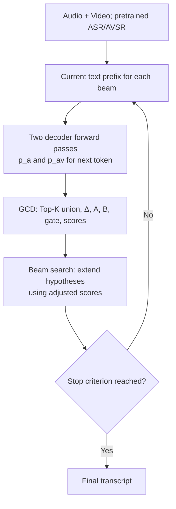

# GCD — Research Report (EMNLP 2026)

> **Paper:** *Gated Contrastive Decoding via Local Candidate Geometry for Audio-Visual Speech Recognition*  
> **Authors:** Da-Hee Yang, Joon-Hyuk Chang  
> **Venue:** EMNLP 2026 (Main) · **Direction:** Training-Free AVSR / Inference-Time Decoding  
> **Paper:** https://aclanthology.org/2026.emnlp-main.1035/  
> **PDF:** https://aclanthology.org/2026.emnlp-main.1035.pdf  
> **Đối chiếu:** §3–5, Figure 1–2, Eq. (1)–(13), Tables 1–3, Limitations và Appendix A.

**Một câu tóm tắt:** GCD **không thay Encoder/Decoder và không cập nhật trọng số**. Ở mỗi bước decoding, thuật toán so sánh phân phối next-token của **AVSR (Audio + Video)** với **ASR (Audio-only)**, kiểm tra tính hữu ích/ổn định của chênh lệch trên tập token ứng viên rồi dùng **Gate động** để điều chỉnh mức Contrastive Decoding.

---

## 1. Overview & Problem

**Problem:** Contrastive Decoding (CD) cho AVSR dùng chênh lệch giữa phân phối **AVSR** và **ASR** để ưu tiên token được Video hỗ trợ. Tuy nhiên, **Uniform CD dùng một hệ số điều chỉnh cố định `α` ở mọi bước sinh token**. Có bước AVSR đã dự đoán rõ ràng, điều chỉnh thêm là không cần thiết; có bước các token cạnh tranh rất sát nhau, điều chỉnh quá mạnh dễ đảo thứ hạng sai. Kết quả là **WER có thể tăng** và CD rất nhạy với cách chọn `α`.

**Câu hỏi nghiên cứu:** Có thể đánh giá *ngay tại mỗi bước decoding* xem chênh lệch AVSR–ASR có đáng tin không, rồi **tăng/giảm contrastive adjustment** mà **không train lại model**?

**Điểm mới:** Một **Gated Contrastive Decoding** dựa trên *local candidate geometry*:

1. Dựng tập ứng viên `C_t` từ **union Top-K** token của cả ASR và AVSR.
2. **Margin Support `A_t`**: contrastive direction có củng cố token AVSR đang ưu tiên so với những token cạnh tranh không?
3. **Dispersion Risk `B_t`**: các giá trị contrastive direction có phân tán/thất thường trên tập ứng viên không?
4. Tính **Gate `g_t`** từ `A_t, B_t`, rồi điều chỉnh độ mạnh CD **theo từng bước sinh token**, thay vì cố định như Uniform CD.

**Phân biệt với hai paper trước:** CAV2vec cải thiện **Encoder** bằng uptraining; MoHAVE thay **FFN Decoder** bằng Hierarchical MoE và cần supervised training; **GCD can thiệp *sau logits* ở inference**, không thiết kế module neural mới để train.

---

## 2. Input / Output & Method

| Thành phần | Input | Output | Có training mới không? |
|---|---|---|---|
| **ASR predictor** | Audio `a` + prefix token `y_<t` | Phân phối next-token `pᵃ_t(y)` | Sử dụng checkpoint đã train |
| **AVSR predictor** | Audio `a` + Video `v` + cùng prefix `y_<t` | Phân phối `pᵃᵛ_t(y)` | Sử dụng checkpoint đã train |
| **GCD module** | Hai phân phối `pᵃ_t`, `pᵃᵛ_t`; `α, β, K` | Điểm token đã điều chỉnh `ℓ̃_t(y)` | **Không** — chỉ là các phép tính lúc inference |
| **Autoregressive decoding** | Log-scores đã điều chỉnh + beam/prefix | Transcript cuối | **Không** |

**Method, theo đúng thứ tự:**

1. Cho audio qua **ASR**; cho cùng audio + video qua **AVSR**. Cả hai cùng nhìn **prefix text hiện tại** (theo từng beam hypothesis).
2. Lấy next-token log-probabilities `[Vocab]` từ mỗi nhánh, không chọn token vội.
3. Lấy union của **Top-K token** hai nhánh; đây là tập `C_t` chứa tối đa `2K` token.
4. Tính `Δ_t(y) = log pᵃᵛ_t(y) − log pᵃ_t(y)` cho từng token trong tập ứng viên.
5. Từ cấu hình các `Δ` ở tập ứng viên, tính **Margin Support `A_t`** và **Dispersion Risk `B_t`**.
6. Tính **Gate** `g_t = A_t / (A_t + β B_t + ε)` và dùng `α g_t` điều chỉnh log-score token.
7. Dùng **beam search** chọn các nhánh transcript khả thi; lặp lại ở bước tiếp theo cho đến khi hoàn tất.

### Quy ước shape

| Ký hiệu | Ý nghĩa |
|---|---|
| `B` | Batch size |
| `N_beam` | Số beam hypotheses tại bước decode (paper dùng beam size 15) |
| `T_a`, `T_v` | Độ dài audio/video feature sequences; tùy preprocessing |
| `D_a`, `D_v`, `D_llm` | Số chiều feature / hidden size (theo checkpoint) |
| `U` | Độ dài transcript hiện tại, tính theo token |
| `Vocab` | Kích thước từ điển token của decoder |
| `K = 10` | Top-K trong thí nghiệm chính; `|C_t| ≤ 2K = 20` |
| `pᵃ_t, pᵃᵛ_t` | Hai phân phối xác suất có cùng vocabulary tại bước `t` |

**Lưu ý:** Shape `[B,T_a,D_a]`, `[B,T_v,D_v]`, `[N_beam,Vocab]` là **shape ở mức logic**; paper không ấn định mọi kích thước feature cho tất cả cấu hình nên không gán số cụ thể khi thiếu checkpoint/config.

---

## 3. Backbone Architecture — Hai Predictors có sẵn

Paper dùng **Llama-AVSR** (không phải AV-HuBERT Encoder–Decoder thuần như CAV2vec/MoHAVE):

- **Audio Encoder:** pretrained **Whisper Medium**.
- **Visual Encoder:** pretrained **AV-HuBERT Large**.
- **Modality-specific projectors:** đưa audio/video features về không gian mà **Llama text decoder** nhận được.
- **Text decoder / language backbone:** thí nghiệm với **Llama-3.1-8B** và **TinyLlama-1.1B**.
- **ASR vs AVSR:** hai checkpoint/predictors hoặc cấu hình conditioning tương ứng: ASR **không dùng Video**, AVSR **dùng cả Audio + Video**. Trong thí nghiệm Llama-3.1-8B, tác giả dùng checkpoint ASR và AVSR công khai; với TinyLlama, nhóm tác giả phải huấn luyện các checkpoint nền trước khi áp dụng GCD. **GCD vẫn training-free** vì bản thân phương pháp không cập nhật checkpoint nào.

### Sơ đồ 1 — Backbone + vị trí gắn GCD

**Cách hiểu:** Phần pretrained chỉ sinh **hai phân phối token**. **GCD là bước xử lý các phân phối này**, **không phải Encoder hoặc Decoder mới**. Sơ đồ trên thể hiện *hai lượt/nhánh tính điểm*; không hàm ý Audio Encoder phải được nhân bản vật lý nếu implementation có thể dùng cache phù hợp.

| Block | Input → Output | Vai trò |
|---|---|---|
| Whisper Medium | Waveform → audio features `[B,T_a,D_a]` | Biểu diễn audio |
| AV-HuBERT Large visual encoder | Video → video features `[B,T_v,D_v]` | Biểu diễn môi/khung hình |
| Modality projectors | Modality features → LLM embeddings | Căn chỉnh feature với đầu vào Llama decoder |
| ASR / AVSR text decoder | Features + previous text tokens → `[N_beam,Vocab]` | Tính hai phân phối next-token |
| **GCD** | Hai phân phối → revised log-scores | **Cải tiến của paper**, dùng công thức, không có trainable weights |
| Beam Search | Log-scores → mở rộng các hypothesis | Sinh transcript theo từng bước |

---

## 4. Proposed Method — Local Candidate Geometry + Adaptive Gate

### Sơ đồ 2 — Full GCD, phóng to phần paper đề xuất

### 4.1. Block 1 — Dual predictive distributions

Với audio `a`, video `v` và prefix văn bản `y_<t`:

\[
p_t^{av}(y) = p(y_t=y\mid y_{<t},a,v),\qquad
p_t^{a}(y) = p(y_t=y\mid y_{<t},a).
\]

Cả hai nhánh dự đoán **xác suất của cùng token `y`**, với **cùng prefix**. Nếu chỉ dùng AVSR, ta sẽ trực tiếp chọn token theo `p_t^{av}`; GCD còn so sánh với nhánh ASR để biết Video làm thứ hạng thay đổi ra sao.

### 4.2. Block 2 — Contrastive direction `Δ_t(y)`

\[
\Delta_t(y)=\log p_t^{av}(y)-\log p_t^a(y).
\]

- `Δ_t(y) > 0`: thêm Video làm token `y` được ưu tiên hơn **tương đối** so với nhánh Audio-only.
- `Δ_t(y) < 0`: token `y` được Audio-only ủng hộ mạnh hơn AVSR.
- Đây là **độ lệch log-probabilities**, **không phải trực tiếp độ tin cậy của video**.

**Uniform CD (baseline)** dùng hệ số cố định:

\[
\tilde\ell_t^{CD}(y)=\log p_t^{av}(y)+\alpha\Delta_t(y).
\]

Nhược điểm: cùng một `α` có thể giúp bước này nhưng phá thứ hạng token ở bước khác.

### 4.3. Block 3 — Local Candidate Set và weight

\[
C_t=\mathrm{TopK}(p_t^{av})\ \cup\ \mathrm{TopK}(p_t^a).
\]

- Paper dùng `K=10`, nên nhiều nhất **20 token ứng viên** (đã loại trùng).
- Union giữ cả token Audio-only đánh giá cao dù token ấy không thuộc Top-K AVSR.
- Chọn token AVSR đang đứng đầu: `y_t^* = argmax_{y∈C_t} p_t^{av}(y)`.
- Trọng số quan trọng trên tập này:

\[
w_t(y)=\frac{p_t^{av}(y)}{\sum_{z\in C_t}p_t^{av}(z)}.
\]

**Vai trò `w_t`:** Các đối thủ có xác suất AVSR cao được xem xét kỹ hơn; ứng viên có xác suất rất thấp ít ảnh hưởng tới đánh giá gate.

### 4.4. Block 4A — Margin Support `A_t`

Đầu tiên tính biên độ chênh lệch trên tập ứng viên:

\[
R_t=\max_{y\in C_t}\Delta_t(y)-\min_{y\in C_t}\Delta_t(y).
\]

Sau đó:

\[
A_t=
\frac{\displaystyle\sum_{y\in C_t\setminus\{y_t^*\}}
  w_t(y)\,[\Delta_t(y_t^*)-\Delta_t(y)]_+}{R_t+\epsilon},
\quad [z]_+=\max(z,0).
\]

**Diễn giải:** Đo **mức độ contrastive signal ủng hộ token AVSR đang đứng đầu** so với các token đang cạnh tranh, có trọng số và chuẩn hóa theo range. `A_t` lớn: việc dùng `Δ` có xu hướng tăng khoảng cách cho token AVSR ưu tiên. Đây là **đánh giá lợi ích cục bộ**, **không bảo đảm token đó đúng ground truth**.

### 4.5. Block 4B — Dispersion Risk `B_t`

\[
\bar\Delta_t=\sum_{y\in C_t} w_t(y)\Delta_t(y),\qquad
B_t=\sum_{y\in C_t} w_t(y)\,|\Delta_t(y)-\bar\Delta_t|.
\]

**Diễn giải:** Tính *weighted mean absolute deviation* của các contrastive directions. `B_t` lớn: độ điều chỉnh giữa các token lân cận phân tán mạnh → nguy cơ làm thứ hạng biến động không ổn định. Paper dùng **MAD**, không phải variance.

**Quan trọng:** `B_t` cao **không tự động khóa CD**. Gate cân bằng `B_t` với mức hỗ trợ `A_t`.

### 4.6. Block 5 — Adaptive Gate `g_t`

\[
\boxed{g_t=\frac{A_t}{A_t+\beta B_t+\epsilon}}\quad\in[0,1].
\]

- `A_t` lớn, `B_t` nhỏ → `g_t` gần 1 → **cho phép CD tác động mạnh**.
- `A_t` nhỏ hoặc `B_t` tương đối lớn → `g_t` giảm → **giữ dự đoán AVSR gốc nhiều hơn**.
- `β` là hyperparameter **phạt dispersion**, còn `ε` nhỏ để tránh chia cho 0.
- **Không có neural gate cần training.** Gate được tính lại ở **mỗi bước decoding** (và mỗi prefix/beam hypothesis tương ứng).

### 4.7. Block 6 — Adjusted token scores

\[
\boxed{\tilde\ell_t(y)=\log p_t^{av}(y)+\alpha g_t\Delta_t(y)}.
\]

**Phân biệt ba cơ chế:**

| | Công thức | Ý nghĩa |
|---|---|---|
| Standard AVSR | `log p_av` | Không chỉnh phân phối |
| Uniform CD | `log p_av + α Δ` | Mọi bước cùng độ mạnh `α` |
| **GCD** | **`log p_av + α g_t Δ`** | `g_t` thay đổi theo local token geometry |

**Chi tiết dễ bỏ sót:** Theo thiết lập paper, **chỉ token trong `C_t` được áp dụng contrastive adjustment**; token **ngoài `C_t` giữ log-probability AVSR ban đầu** trong beam expansion. Do đó không phải mọi token trong vocabulary đều bị thay đổi điểm.

---

## 5. Inference — Luồng triển khai và chi phí

### Sơ đồ 3 — Autoregressive decoding loop

**Một lần xử lý token (với một beam hypothesis):**

1. Model có prefix, ví dụ `"I want"`.
2. ASR và AVSR mỗi bên trả log-probabilities cho **toàn vocabulary** (chưa sinh token độc lập).
3. GCD xem Top-K của hai bên, tính chênh lệch, `A_t`, `B_t` và `g_t`.
4. GCD tạo log-scores đã điều chỉnh; beam search dùng các score này để **mở rộng hypothesis**.
5. Lặp với prefix mới. Cuối quá trình chọn transcript theo kết quả beam search.

**Không hiểu nhầm:** Hai nhánh **không phải** mỗi bên sinh ra transcript hoàn chỉnh rồi mới so sánh. Việc so sánh diễn ra **theo token tại từng bước**.

### Cấu hình thực nghiệm trong paper

| Thiết lập | Giá trị |
|---|---|
| Candidate Top-K mỗi nhánh | `K = 10` |
| Beam size | `15` |
| Contrastive strength | `α = 0.1` |
| Dispersion coefficient | `β = 1.0` |
| Numerical stability | `ε = 1e-8` |
| Backbones | Llama-3.1-8B và TinyLlama-1.1B (trong Llama-AVSR) |
| Compute đánh giá | NVIDIA A100 |

**Chi phí:** GCD cần **cả ASR và AVSR decoder forward tại mỗi bước**, nên paper ghi nhận **xấp xỉ gấp đôi backbone decoding computation** so với standard AVSR. Phần phép tính Top-K/gate thêm vào tương đối nhỏ. **Training-free không có nghĩa là inference miễn phí**.

---

## 6. Results & Contributions

### Benchmark & metrics

- **LRS3:** kiểm tra cả clean audio và audio cộng **CHiME-4 environmental noise** tại SNR `−15, −10, −5, 0 dB`.
- **LRS2:** đánh giá chuyển dataset, **không fine-tune trên LRS2**.
- **WER** = (substitution + deletion + insertion) / số từ transcript tham chiếu. **INS** = tỷ lệ lỗi chèn từ. Cả hai **càng thấp càng tốt**.

### LRS3 — Llama-3.1-8B (Table 1, WER % ↓)

| Audio condition | ASR | AVSR baseline | Uniform CD | **GCD** |
|---|---:|---:|---:|---:|
| −15 dB | 91.07 | 23.49 | 22.45 | **21.66** |
| −10 dB | 67.57 | 17.08 | 16.96 | **15.90** |
| −5 dB | 29.72 | 8.36 | 8.80 | **7.84** |
| 0 dB | 8.28 | 3.79 | 3.71 | **3.30** |
| Clean | 1.21 | 0.80 | 0.78 | **0.78** |

**Ví dụ nổi bật:** tại `−5 dB`, **Uniform CD làm WER xấu hơn** (`8.36 → 8.80%`), còn **GCD cải thiện** (`8.36 → 7.84%`). Đây là minh họa rõ cho vấn đề *fixed α may hurt some decoding steps*.

### LRS3 — TinyLlama (Table 1, WER % ↓)

| Audio condition | AVSR | Uniform CD | **GCD** |
|---|---:|---:|---:|
| −15 dB | 31.73 | 26.83 | **26.09** |
| −10 dB | 24.13 | 21.55 | **20.23** |
| −5 dB | 15.76 | 13.43 | **12.37** |
| 0 dB | 6.91 | 6.57 | **5.58** |
| Clean | 2.58 | 1.63 | **1.45** |

### LRS2 cross-dataset (Llama-3.1-8B; Table 2)

| Condition | AVSR | Uniform CD | **GCD** |
|---|---:|---:|---:|
| −15 dB | 44.73 | 33.68 | **32.82** |
| −10 dB | 30.11 | 27.70 | **26.56** |
| −5 dB | 17.40 | 17.33 | **16.04** |
| 0 dB | 8.68 | 9.40 | **8.65** |
| Clean | 4.38 | 4.44 | **4.22** |

### Ablation và độ nhạy (Table 3 / Figure 2)

| LRS3, −10 dB | Llama-3.1-8B WER ↓ | TinyLlama WER ↓ |
|---|---:|---:|
| **GCD đầy đủ** | **15.90** | **20.23** |
| Bỏ `A_t` (thay `A_t = 1`) | 16.16 | 20.61 |
| Bỏ `B_t` | 16.96 | 21.55 |
| AVSR baseline | 17.08 | 24.13 |

- **Bỏ `B_t` gây suy giảm lớn nhất**: Gate gần trở lại Uniform CD → thành phần dispersion quan trọng để tránh điều chỉnh không ổn định.
- Khi thay đổi `α` trong khoảng khảo sát của tác giả trên LRS3 tại `−10 dB`, **Llama-3.1-8B Uniform CD biến thiên 4.28 điểm WER**, còn **GCD chỉ 0.07 điểm WER**. Đây là bằng chứng paper nhấn mạnh về **giảm sensitivity với hyperparameter**.

### Đóng góp và giới hạn

**Contributions:** (1) Chỉ ra Uniform CD không phù hợp mọi bước/token; (2) định nghĩa local candidate geometry bằng Margin Support + Dispersion Risk; (3) gate động, training-free; (4) tăng robustness WER và ít nhạy với `α` trên LRS3/LRS2.

**Limitations từ chính paper:**

1. Gate đặt AVSR prediction làm tham chiếu nhưng **không chứng minh token AVSR đang ưu tiên là đúng**. Nếu AVSR tự tin nhưng sai, gate vẫn có thể củng cố token sai.
2. `B_t` **chưa được chuẩn hóa theo local contrastive range**, khiến độ cân bằng `A_t` và `B_t` vẫn phụ thuộc scale giữa các bước.
3. Cần **hai đường dự đoán ASR + AVSR**, chi phí decoding gần **gấp đôi** standard AVSR, dù **không cần retraining**.

**Takeaway:** GCD không phải một Encoder tốt hơn hoặc một Decoder có cấu trúc mới. Điểm mới nằm ở **logic chấm điểm và chọn token khi inference**: so sánh AVSR–ASR, ước lượng *hỗ trợ* và *rủi ro* trên các token cạnh tranh, rồi **gate mức áp dụng Contrastive Decoding theo từng bước**.

---

## Nguồn đối chiếu

1. [ACL Anthology — GCD (EMNLP 2026)](https://aclanthology.org/2026.emnlp-main.1035/)
2. [Official paper PDF — Figure 1, Eq. 1–13, Tables 1–3, Appendix](https://aclanthology.org/2026.emnlp-main.1035.pdf)

*Định dạng: Markdown chuẩn + 3 sơ đồ Mermaid. Các sơ đồ là diễn giải phục vụ nghiên cứu, không phải ảnh sao chép nguyên văn từ paper. Các shape không được ấn định trong paper được ghi bằng biến thay vì tự đoán.*
