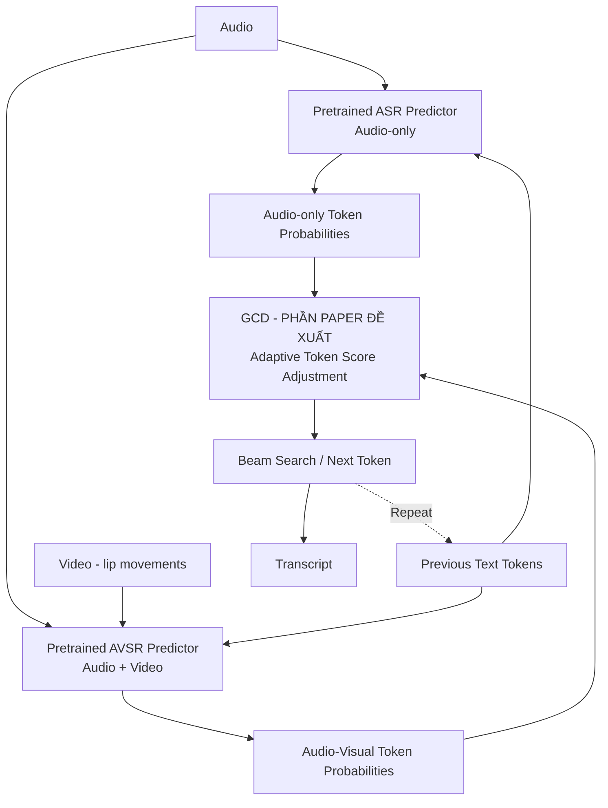
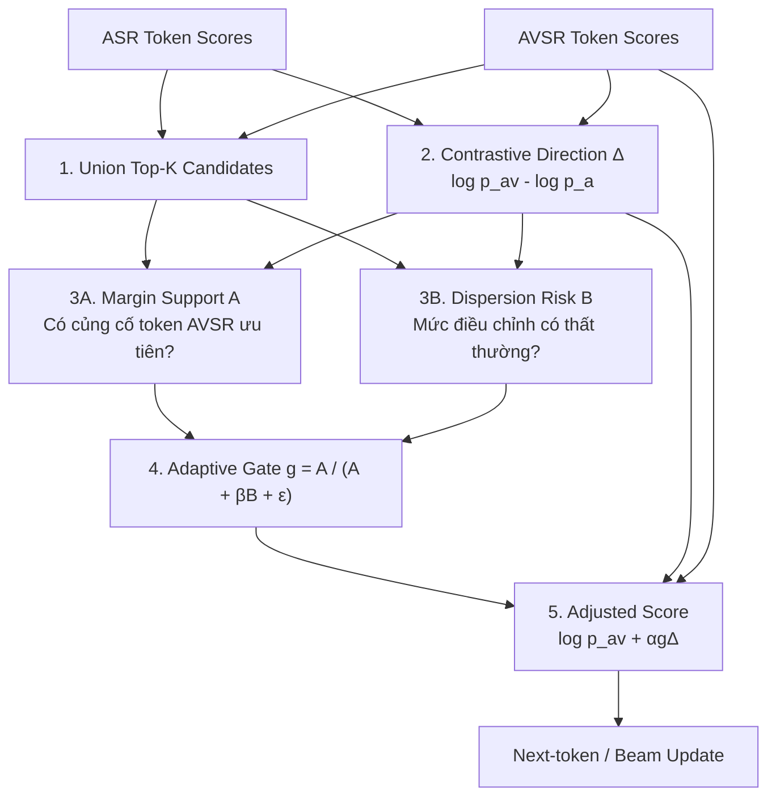

# GCD — Short Research Report

**Paper:** *Gated Contrastive Decoding via Local Candidate Geometry for Audio-Visual Speech Recognition*  
**Venue:** EMNLP 2026 · **Hướng:** Training-Free AVSR / Adaptive Decoding  
**Backbone trong thí nghiệm:** **Llama-AVSR** (Whisper Medium Audio Encoder + AV-HuBERT Large Visual Encoder + Llama text decoder); ASR và AVSR predictors đã được huấn luyện trước.  
**Nguồn:** [Paper](https://aclanthology.org/2026.emnlp-main.1035/) · [PDF](https://aclanthology.org/2026.emnlp-main.1035.pdf)

## 1. Input

- **Audio + Video** người nói (audio có thể nhiễu).
- **Hai phân phối next-token** tại mỗi bước: `p_a` từ **ASR Audio-only** và `p_av` từ **AVSR Audio+Video**.
- Các token văn bản đã sinh trước đó được dùng chung cho hai nhánh.

## 2. Output

- **Transcript**: văn bản nhận dạng tiếng nói.
- GCD không tạo Encoder/Decoder mới; output trung gian là **điểm token đã điều chỉnh**.

## 3. Problem

**Uniform Contrastive Decoding (CD) dùng cùng một hệ số điều chỉnh `α` cho mọi bước sinh token.** Nhưng có bước chênh lệch ASR–AVSR hữu ích, có bước lại làm đảo thứ hạng token không ổn định và tăng WER. **Vấn đề:** làm sao chỉ tăng mạnh contrastive adjustment khi nó đáng tin, **không cần train lại model**?

## 4. Method & Architecture

**Ý tưởng:** Dùng **Gated Contrastive Decoding** ở inference. So sánh dự đoán ASR và AVSR, đánh giá sự ổn định của chênh lệch trên các token cạnh tranh, rồi tính **Gate động cho từng bước sinh token**.

### Sơ đồ 1 — Overall Architecture

### Sơ đồ 2 — Bên trong GCD (phần cải tiến)

**Giải thích từng block:**

1. **Dual Predictors:** ASR và AVSR cùng dự đoán xác suất **token tiếp theo**, với chung text prefix; không phải sinh hai transcript hoàn chỉnh để so sánh.
2. **Top-K + Contrastive Direction:** Lấy union Top-K của hai nhánh (`K=10` trong paper) và tính `Δ = log p_av − log p_a` để biết Video làm điểm token thay đổi ra sao.
3. **Margin Support `A` / Dispersion Risk `B`:** Đánh giá liệu contrastive signal có **ủng hộ token AVSR đang đứng đầu** và có **ổn định giữa những token cạnh tranh** không.
4. **Adaptive Gate `g`:** `g` cao → điều chỉnh mạnh; `g` thấp → giữ dự đoán AVSR gốc nhiều hơn. Gate được **tính bằng công thức, không train**.
5. **Adjusted Score + Beam Search:** Dùng `log p_av + αgΔ` cho token trong tập ứng viên, cập nhật các giả thuyết transcript và lặp đến khi hoàn thành.

### Kết quả chính (LRS3, Llama-3.1-8B; WER % ↓)

| SNR | AVSR | Uniform CD | **GCD** |
|---|---:|---:|---:|
| −10 dB | 17.08 | 16.96 | **15.90** |
| −5 dB | 8.36 | 8.80 | **7.84** |
| Clean | 0.80 | 0.78 | **0.78** |

**Điểm cần nhớ:** Không có **GCD training/fine-tuning**. Các ASR/AVSR checkpoints vẫn phải được train từ trước. Đổi lại, GCD cần **hai đường decoder forward tại mỗi bước**, gần **gấp đôi decoding computation** so với một AVSR predictor theo Limitations của paper.

**Kết luận một câu:** GCD **giữ model pretrained, chỉ cải thiện cách điều chỉnh và chọn token lúc inference** bằng Gate dựa trên Margin Support và Dispersion Risk, thay vì dùng hệ số Contrastive Decoding cố định.

---

**Ghi chú:** Hai sơ đồ Mermaid là bản tối giản phục vụ thuyết trình, dựa theo Figure 1 và §4–5 của paper; không phải sao chép hình nguyên bản.
