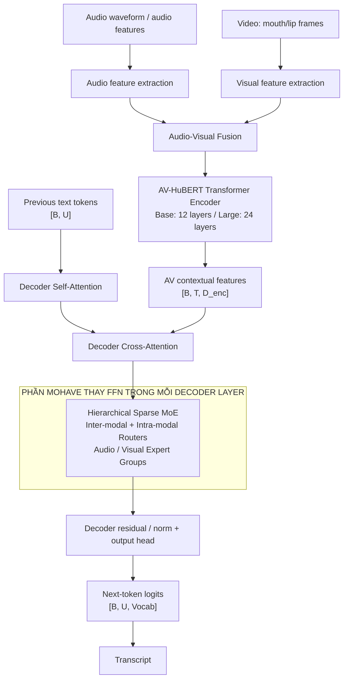
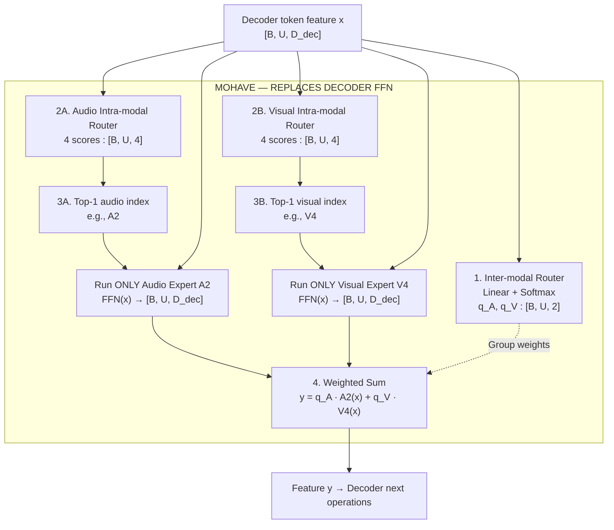
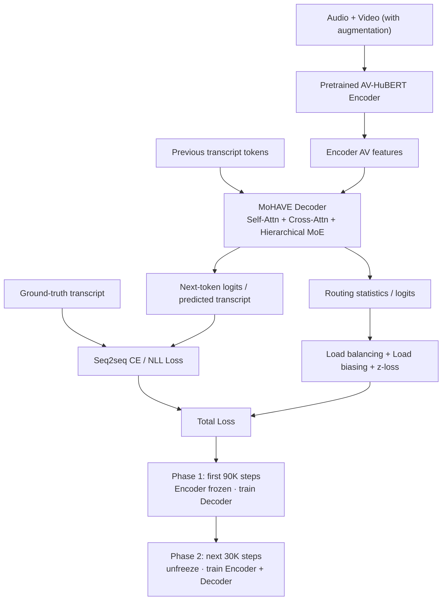

# MoHAVE — Research Report (ICML 2025)

> **Paper:** *MoHAVE: Mixture of Hierarchical Audio-Visual Experts for Robust Speech Recognition*  
> **Authors:** Sungnyun Kim, Kangwook Jang, Sangmin Bae, Sungwoo Cho, Se-Young Yun  
> **Venue:** ICML 2025 · **Direction:** Robust AVSR / Efficient Scaling / Adaptive Audio–Visual Routing  
> **Paper:** https://proceedings.mlr.press/v267/kim25i.html  
> **arXiv (HTML):** https://arxiv.org/html/2502.10447  
> **Đối chiếu:** Figure 2–3; §3–5; Table 1–2; Appendix A.1–A.2.

**Một câu tóm tắt:** MoHAVE giữ **AV-HuBERT Encoder pretrained**, thay **FFN trong mỗi Transformer Decoder layer** bằng **Hierarchical Sparse MoE**: Inter-modal Router quyết định trọng số hai nhóm Audio/Visual; mỗi Intra-modal Router chọn **1/4 Expert** của nhóm mình; chỉ **2/8 Experts** thực sự chạy cho mỗi token. Training bổ sung **group-level load biasing** để hai nhóm học chuyên biệt.

---

## 1. Overview & Problem

### Problem

AVSR sử dụng cả tiếng nói (audio) và chuyển động môi (video), nhưng còn hai khó khăn liên quan:

1. **Scalability–compute trade-off:** Tăng kích thước các Transformer/FFN thông thường làm tăng cả tham số **lẫn lượng tính toán cho mỗi token**. Model lớn hơn chưa chắc cải thiện khả năng tận dụng Video tương ứng với Audio.
2. **Adaptive modality usage:** AVSR thường dựa nhiều vào Audio. Khi tiếng nói nhiễu nặng, Video nên đóng góp nhiều hơn, nhưng **routing cứng** theo loại đầu vào hoặc một MoE chung không nhất thiết tự thích nghi tối ưu với từng mức nhiễu.

**Câu hỏi nghiên cứu:** Làm sao **mở rộng capacity của Decoder** bằng nhiều Experts mà không kích hoạt tất cả, và **tự điều chỉnh mức sử dụng nhóm Audio/Video Experts** theo thông tin đầu vào?

**Khác CAV2vec:** CAV2vec tập trung **uptrain Encoder** để tạo representation bền vững trước corruption; **MoHAVE** tập trung **kiến trúc Decoder + cách điều phối Experts** khi sinh transcript. MoHAVE không dùng một giai đoạn Teacher–Student Uptraining riêng.

**Đóng góp trọng tâm của MoHAVE** (không chỉ là việc có MoE):
- **Sparse Experts:** Chia FFN thành các expert FFN, chỉ chạy một số Expert/token.
- **Hierarchical Gating:** Hai cấp Router: **inter-modal** (trọng số nhóm) và **intra-modal** (chọn Expert trong nhóm).
- **Group-level Load Biasing Loss:** Huấn luyện để chuyên biệt hóa nhóm Audio và nhóm Visual, đồng thời cho phép thay đổi trọng số động ở đầu vào audio+video.

---

## 2. Input / Output & Method

| Giai đoạn | Input | Output / Target | Phần được học |
|---|---|---|---|
| **Supervised fine-tuning — Phase 1** | Audio + vùng miệng Video; có transcript nhãn; dùng augmentation/noise và modality dropout trong training | Dự đoán token transcript; so sánh với ground truth | **MoHAVE Decoder**, gồm Self-/Cross-Attention, Routers, Experts và output head; **Encoder frozen** |
| **Supervised fine-tuning — Phase 2** | Cùng dữ liệu AVSR có nhãn | Transcript prediction loss + auxiliary routing losses | **Encoder + MoHAVE Decoder** |
| **Inference** | Audio + Video (có thể nhiễu); các token văn bản đã sinh | **Transcript** cuối cùng | Không cập nhật trọng số; Router chọn Experts lúc chạy |

**Method, tóm tắt theo luồng:**

1. Khởi tạo **AV-HuBERT pretrained** làm Audio-Visual Encoder, sinh `Enc(audio, video)`.
2. Decoder nhận **previous text tokens** và dùng **Cross-Attention** để lấy thông tin từ Encoder features.
3. Ở **vị trí FFN** trong từng Decoder Transformer block, thay FFN bằng **Hierarchical MoE**.
4. Router cấp nhóm học hai trọng số `q_A(x), q_V(x)`; mỗi Router trong nhóm tính điểm 4 Experts, chọn **Top-1**.
5. **Chỉ hai Expert được chọn** (mỗi nhóm một) xử lý token feature `x`; gộp output theo `q_A, q_V`, rồi Decoder dự đoán token văn bản.
6. Train với **transcript CE/NLL loss + load balancing + load biasing + router z-loss**; **90K steps Encoder frozen, 30K steps tiếp train cả Encoder–Decoder** (thiết lập LRS3 trong paper).

### Quy ước shape (mang tính kiến trúc, không tự đoán config)

| Ký hiệu | Nghĩa |
|---|---|
| `B` | Batch size |
| `T` | Số bước thời gian của encoder features sau preprocessing |
| `U` | Số text token đang được Decoder xử lý |
| `D_enc` | Hidden dimension của AV-HuBERT Encoder, theo Base/Large |
| `D_dec` | Hidden dimension của Decoder, theo cấu hình model |
| `Vocab` | Vocabulary size của Text Decoder |
| `N_A = N_V = 4` | Số Expert của mỗi nhóm, tổng **8 Experts / MoE layer** |

**Ví dụ minh họa:** Với `B=1`, `U=12`, mỗi token feature đưa vào MoE có `D_dec` chiều. Inter-modal Router tạo **2 điểm** `[1,12,2]`; mỗi Intra-modal Router tạo **4 điểm** `[1,12,4]`. Số chiều `D_dec` giữ bằng ký hiệu vì báo cáo paper không yêu cầu chốt riêng từng checkpoint.

---

## 3. Backbone Architecture — AV-HuBERT Encoder + MoHAVE Decoder

**Nguồn gốc kiến trúc:** Audio-Visual Encoder của **AV-HuBERT Base/Large pretrained** được giữ về cấu trúc. Phần **mới** là **thay FFN Decoder** bằng Hierarchical MoE ở mỗi Decoder layer. Đây **không** phải thêm Router trực tiếp ngay sau Encoder và cũng **không** phải xây một Text Decoder ngoài mô hình để chạy nối tiếp.

### Sơ đồ 1 — Toàn bộ model (đánh dấu phần mới)



> **Sơ đồ đơn giản hóa:** `SELF → CROSS → MoE` là **luồng bên trong một Decoder layer**; quá trình này lặp **6 lần** (Base) hoặc **9 lần** (Large). Hình rút gọn các Add & Norm và output projection. Đối chiếu Figure 2–3 / §5.1.

### Vai trò từng block

| Block | Input → Output | Làm gì? | Cũ / Mới |
|---|---|---|---|
| Audio feature extraction | Audio → `[B,T,D_enc]` (trong encoder pipeline) | Trích đặc trưng âm thanh, đưa về kích thước encoder | **Có sẵn** |
| Visual feature extraction | Mouth video → `[B,T,D_enc]` (sau projection) | Trích đặc trưng vùng miệng | **Có sẵn** |
| AV Fusion + AV-HuBERT Encoder | Audio/Video features → `[B,T,D_enc]` | Kết hợp hai modality và học ngữ cảnh lời nói | **Có sẵn** |
| Decoder Self-Attention | Previous text token embeddings → `[B,U,D_dec]` | Cho token văn bản xem ngữ cảnh token trước | **Có sẵn** |
| Decoder Cross-Attention | `[B,U,D_dec]` + encoder `[B,T,D_enc]` → `[B,U,D_dec]` | Cho Decoder khai thác thông tin lời nói Audio–Video | **Có sẵn** |
| **Hierarchical MoE** | Token feature `x` → `y` cùng `D_dec` | Phân bổ trọng số theo nhóm, chọn Expert, biến đổi feature | **Paper đề xuất, thay FFN** |
| Output head | Decoder features → `[B,U,Vocab]` | Dự đoán token transcript | **Có sẵn** |

### MoHAVE Base và Large (paper §5.1)

| Cấu hình | Encoder layers | Decoder layers | MoE mỗi Decoder FFN | Tổng Experts / MoE |
|---|---:|---:|---|---:|
| MoHAVE-Base | 12 | 6 | Hierarchical MoE | 8 = 4 Audio + 4 Visual |
| MoHAVE-Large | 24 | 9 | Hierarchical MoE | 8 = 4 Audio + 4 Visual |

**Lưu ý về modality:** Sau Cross-Attention, `x` là **text token feature đã chứa ngữ cảnh Audio–Video**. Audio Router và Visual Router **đều nhận cùng `x`**, không nhận raw waveform và raw frame riêng.

---

## 4. Hierarchical MoE — Phương pháp chính & Training Objectives

### 4.1. Sơ đồ 2 — Phóng to **một MoE layer** (Figure 3c)



> Ví dụ `A2`, `V4` và `q_A=0.3, q_V=0.7` là **giá trị minh họa**, không phải lựa chọn mặc định. Paper chọn **Top-1 trong mỗi nhóm**, tức **2/8 Expert FFNs chạy trên mỗi token**. Điểm số của Router cho các Expert chưa đồng nghĩa với việc chạy tất cả FFN.

### 4.2. Logic từng block (thứ tự quan trọng)

**Block 1 — Inter-modal Router: chọn *mức đóng góp của hai nhóm***

- **Input:** `x` từ Cross-Attention, shape `[B,U,D_dec]`.
- **Operation:** Một phép chiếu tuyến tính `u(x)=V_r x`, sau đó `softmax` để tạo `[q_A(x), q_V(x)]`.
- **Output:** Hai xác suất/weight cho **Audio Expert Group** và **Visual Expert Group**. Ví dụ `0.3` và `0.7`.
- **Không phải:** Một bộ đo SNR trực tiếp hoặc bộ tách audio/video thành hai dòng mới.

**Block 2 — Hai Intra-modal Routers: chọn *Expert cụ thể trong từng nhóm***

- Cả hai nhận **cùng feature `x`**.
- **Audio Router:** Chiếu `x → 4 scores`, chọn `argmax` trong `A1..A4`.
- **Visual Router:** Chiếu `x → 4 scores`, chọn `argmax` trong `V1..V4`.
- **Điểm mấu chốt:** Chỉ phải tính **4 routing scores cho mỗi nhóm**; **chưa chạy 8 FFN** để lấy scores.

**Block 3 — Selected Experts: chỉ bây giờ mới chạy FFN**

- Giả sử chọn `A2` và `V4`.
- Chỉ chạy **`A2(x)` và `V4(x)`**, mỗi Expert là một **FFN riêng** (hai Fully-Connected layers + activation) có tham số đã học.
- Các FFN `A1`, `A3`, `A4`, `V1`, `V2`, `V3` **không thực hiện forward cho token đó**.
- Cả hai Expert nhận `x`, cùng trả về feature kích thước `[B,U,D_dec]` (thực tế xử lý/dispatch theo từng token được chọn).

**Block 4 — Weighted Sum: gộp output**

`y = q_A(x) · A_selected(x) + q_V(x) · V_selected(x)`

- Kết quả giữ chiều `D_dec`; quay về đường residual/norm tiếp theo của Decoder.
- MoE **không trực tiếp tạo transcript**: nó xử lý token feature, rồi output head mới dự đoán next-token.

### 4.3. Số Experts được chạy: capacity khác compute

**Đối chứng khái niệm:**

- **Dense FFN bình thường:** Có một FFN, mỗi token chạy *toàn bộ* trọng số FFN đó.
- **Dense 8 Experts giả định:** Có 8 FFN và chạy *cả 8* → tăng tính toán mạnh.
- **Sparse MoHAVE:** Có 8 FFN nhưng **mỗi token chỉ chạy 1 Audio + 1 Visual Expert**, nên *tổng capacity* (tổng tham số) lớn hơn *số tham số được kích hoạt*.

**Không được kết luận sai:** `activated parameters < total parameters` **không có nghĩa** MoHAVE chạy ít FLOPs hơn AV-HuBERT gốc. Với cùng phép đo của paper (**500 audio-visual frames + 50 text tokens**), MoHAVE-Base cần **14.8 GFLOPs/sequence**, so với **AV-HuBERT-Base: 12.1**; MoHAVE-Large: **39.3** so với **32.2**. Ý nghĩa là **tăng capacity nhiều, tăng compute tương đối ít**, không phải giảm tuyệt đối compute so với backbone gốc.

### 4.4. Training giúp hai nhóm trở thành Audio/Visual Experts thế nào?

Đây là điểm mà **sơ đồ inference không thể hiện**.

- **Modality dropout khi training:** Tạo các mẫu **audio-only** hoặc **video-only** (paper ghi xác suất drop một modality là 25%). Một phần mẫu còn giữ cả audio+video.
- **Group-level Load Biasing Loss (`L_S`):** Với **audio-only**, khuyến khích Inter-modal Router ưu tiên **Audio Group**; với **video-only**, ưu tiên **Visual Group**. **Audio+Video samples không tham gia `L_S`**, nhưng vẫn đóng góp các loss liên quan khác.
- **Transcript Loss (`L_CE`):** Dạy **Decoder và các Expert** biến đổi features để sinh đúng token văn bản.
- **Expert Load Balancing (`L_B`):** Tránh Router dồn nhiều token vào vài Expert, để các Expert trong nhóm được sử dụng cân đối hơn.
- **Router z-loss (`L_Z`):** Ổn định giá trị logits/hoạt động routing.

**Tổng loss từ Eq. (15):**

\[
L_{total} = L_{CE} + 10^{-2}L_B + 10^{-2}L_S + 10^{-3}L_Z
\]

**Lưu ý:** Training **không cấp sẵn nhãn** rằng token này có SNR bao nhiêu hay trọng số Audio/Video phải là `0.3/0.7`. Các Router tự học từ gradient và auxiliary losses. Trong audio+video inference, Inter-modal Router tự phân bổ trọng số theo context.

### 4.5. Sơ đồ training signal (bổ trợ sơ đồ 2)

```text
Audio + Video + ground-truth transcript
  ├─ Pretrained AV-HuBERT Encoder → AV Features
  ├─ Decoder (attention + MoHAVE Experts) → token logits
  │     └─ L_CE: so với transcript ground truth
  ├─ Intra-modal routing probabilities → L_B (balanced load)
  ├─ Audio-only / Video-only samples → L_S (group specialization)
  └─ Router logits → L_Z (stability)
                      ↓
               L_total / Backprop
                      ↓
      Train Decoder first → then Encoder + Decoder
```

---

## 5. Supervised Fine-tuning & Inference

### 5.1. Sơ đồ 3 — Train chính xác phần nào?



**Theo thiết lập LRS3 trong Appendix A.2:**

| Giai đoạn | AV-HuBERT Encoder | MoHAVE Decoder | Loss |
|---|---|---|---|
| **Steps 1–90K** | **Frozen** | **Train** (attention, Routers, Experts, output head) | Transcript NLL/CE + routing losses |
| **Steps 90K–120K** | **Train / Unfreeze** | **Train** | Cùng mục tiêu |
| **Inference** | Eval | Eval; sparse routing | Không tính training loss |

**Đây là supervised fine-tuning ngay từ đầu**, không có Teacher–Student Uptraining như CAV2vec. Sơ đồ này diễn giải *hai phase của cùng quá trình fine-tune*, không phải hai phương pháp tách rời.

**Chi tiết paper công bố:** LRS3 fine-tune 120K steps; optimizer Adam, learning rate `5e-4`, warmup + polynomial decay; mỗi bước xử lý ~8.000 audio-visual frames (≈320 giây tiếng nói). Audio noise augmentation được dùng khi train; loss token là **Seq2Seq NLL**, **không dùng CTC decoding**.

### 5.2. Inference chạy ra transcript như thế nào?

1. Audio + Video qua Encoder → `Z` (`[B,T,D_enc]`).
2. Decoder nhận các token trước đó và `Z` qua Self-/Cross-Attention.
3. Ở mỗi Decoder layer, Hierarchical MoE chọn **1 Expert/nhóm** cho từng token feature và gộp output.
4. Output head tạo next-token logits `[B,U,Vocab]`; decoding chọn token tiếp theo, lặp đến token kết thúc.
5. **Output cuối:** Transcript.

Paper dùng **beam search, beam size = 50** trong thí nghiệm LRS3. Inference không dùng ground-truth, load-biasing loss, backprop hay cập nhật trọng số.

---

## 6. Results & Contributions

### 6.1. Kết quả LRS3 (Table 1–2)

- **LRS3:** ~433 giờ Audio–Video từ hơn 5.000 speakers.
- **N-WER:** Trung bình WER trên **4 loại nhiễu** (babble, speech, music, natural) × **5 mức SNR** (`−10, −5, 0, 5, 10 dB`); càng **thấp** càng tốt.
- **C-WER:** WER trên Audio sạch; không nên trộn với N-WER.

| Model | Total params | Activated params | **N-WER ↓** | C-WER ↓ | Compute / sequence |
|---|---:|---:|---:|---:|---:|
| AV-HuBERT-Base | 161M | 161M | 6.6% | 2.1% | 12.1 GFLOPs |
| **MoHAVE-Base** | **359M** | **189M** | **5.8%** | **1.8%** | **14.8 GFLOPs** |
| AV-HuBERT-Large | 477M | 477M | 5.7% | **1.4%** | 32.2 GFLOPs |
| **MoHAVE-Large** | **~1.0B** | **553M** | **4.5%** | 1.5% | **39.3 GFLOPs** |

**Diễn giải đúng:** MoHAVE-Large giảm N-WER từ **5.7 → 4.5** (giảm **1.2 điểm phần trăm**, ~**21.1% tương đối**) so với AV-HuBERT-Large, **nhưng C-WER tăng nhẹ từ 1.4 → 1.5**. FLOPs của MoHAVE cũng **tăng**, chỉ tăng ít so với mức tăng total params.

### 6.2. Ablation: vì sao không chỉ cần MoE bình thường?

| Large model (Table 2) | N-WER ↓ |
|---|---:|
| AV-MoE-Large thông thường, 8 Experts | 5.7% |
| Hard Routing, 2 nhóm Experts nhưng trọng số nhóm không học thích nghi | 4.8% |
| MoHAVE-Large **bỏ Load Biasing** | 5.6% |
| **MoHAVE-Large đầy đủ** | **4.5%** |

Kết quả cho thấy **có nhiều Experts thôi chưa đủ**. Việc chia nhóm theo modality, học trọng số nhóm động và khuyến khích chuyên biệt nhóm là các thành phần quan trọng trong thiết lập của paper.

### 6.3. Đóng góp & đánh đổi

**Đóng góp:**

1. **Decoder capacity scaling:** Dùng tổng số tham số Expert lớn hơn, nhưng **sparse activation 2/8 FFNs / token**.
2. **Adaptive modality routing:** Inter-modal Router thay đổi tỷ trọng nhóm Audio/Visual theo context; Intra-modal chọn Expert cụ thể.
3. **Specialization training:** Group-level Load Biasing giúp hai nhóm phát triển khả năng chuyên biệt; paper quan sát xu hướng tăng trọng số Visual khi Audio nhiễu nặng.
4. **Robust benchmark gains:** N-WER tốt hơn trên LRS3; paper cũng có thí nghiệm **MuAViC** đa ngôn ngữ và dịch speech-to-text (đánh giá WER/BLEU).

**Giới hạn cần nói rõ:**

- **Không phải giảm FLOPs tuyệt đối** so với AV-HuBERT gốc; MoHAVE Base/Large đều có compute cao hơn baseline tương ứng.
- **Không phải mọi loại nhiễu** đều đảm bảo hiệu quả; và trong clean conditions, cải thiện có thể nhỏ hoặc không cải thiện.
- **Không phải chỉ Decoder được train suốt quá trình**: Decoder-only lúc đầu, rồi train **cả Encoder+Decoder**.
- Số liệu là từ setup của tác giả, không nên so trực tiếp với CAV2vec/GCD nếu khác benchmark, noise hoặc training data.

**Takeaway:** Điểm mới của MoHAVE nằm ở **thay FFN trong Decoder bằng Expert groups + Hierarchical Routers**, và **dạy Router/Experts chuyên biệt bằng Load Biasing**. Token được **chọn Expert trước → mới chạy hai FFN được chọn → weighted sum → dự đoán transcript**. Đây là cải tiến **kiến trúc và routing trong Decoder**, không phải cải tiến pretraining Encoder như CAV2vec.

---

## Nguồn đối chiếu

1. **Paper chính thức (ICML/PMLR):** https://proceedings.mlr.press/v267/kim25i.html
2. **arXiv HTML, có công thức, bảng & Appendix:** https://arxiv.org/html/2502.10447
3. **PDF Figure 2–3:** https://arxiv.org/pdf/2502.10447

*Định dạng: Markdown chuẩn + **3 sơ đồ Mermaid** (toàn bộ model, chi tiết MoE, quá trình training), bảng và công thức. Các hình Mermaid là sơ đồ diễn giải lại từ paper, không sao chép hình gốc.*
