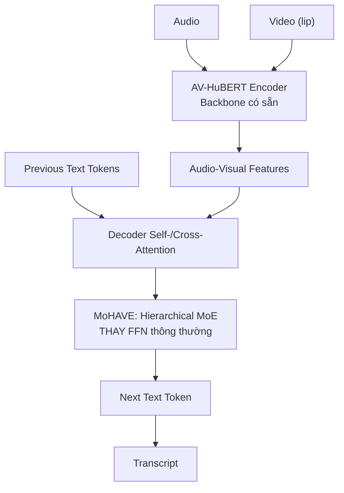
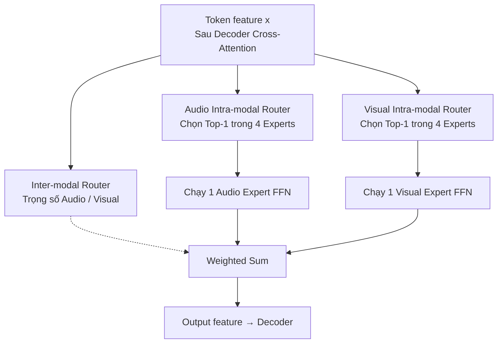

# MoHAVE — Short Research Report

**Paper:** *MoHAVE: Mixture of Hierarchical Audio-Visual Experts for Robust Speech Recognition*  
**Venue:** ICML 2025 · **Hướng:** Robust AVSR / Efficient MoE / Audio–Visual Routing  
**Backbone:** **AV-HuBERT pretrained Encoder**; Decoder thay FFN bằng **Hierarchical MoE** (Base: 12 Encoder + 6 Decoder layers; Large: 24 + 9).  
**Nguồn:** [Paper](https://proceedings.mlr.press/v267/kim25i.html) · [arXiv HTML](https://arxiv.org/html/2502.10447)

## 1. Input

- **Training:** Audio + Video vùng miệng, **ground-truth transcript**; có audio noise augmentation và lúc train tạo thêm mẫu audio-only/video-only.
- **Inference:** Audio + Video của người nói (có thể nhiễu).

## 2. Output

- **Training:** Model học dự đoán đúng token của transcript và học phân bổ thông tin qua Audio/Visual Experts.
- **Inference:** **Transcript** — văn bản lời nói nhận dạng được.

## 3. Problem

Các mô hình AVSR thường **phụ thuộc nhiều vào Audio**, chưa linh hoạt dùng Video khi Audio bị nhiễu. Đồng thời, tăng kích thước Decoder theo kiểu thông thường khiến chi phí tính toán tăng. **Bài toán:** mở rộng năng lực model và sử dụng hai modality linh hoạt **mà không phải chạy toàn bộ tham số Expert**.

## 4. Method & Architecture

**Ý tưởng:** Giữ **AV-HuBERT Encoder pretrained**, thay **FFN trong từng Transformer Decoder layer** bằng **Hierarchical Sparse MoE**. Mỗi MoE gồm **4 Audio Experts + 4 Visual Experts**; Router chọn **1 Expert mỗi nhóm** trước khi Expert xử lý token.

### Sơ đồ 1 — Overall Architecture

### Sơ đồ 2 — Hierarchical MoE (phần paper đề xuất)

**Giải thích 4 block chính:**

1. **Inter-modal Router:** Nhận token feature đã tích hợp ngữ cảnh AV, tính **tỷ trọng hai nhóm**, ví dụ Audio 30% / Visual 70%.
2. **Intra-modal Routers:** Mỗi router nhận **cùng token feature**, tính điểm cho **4 Experts trong nhóm** và chọn **Top-1**.
3. **Selected Experts:** **Chỉ 2/8 FFN Experts** thực sự chạy; 6 Experts còn lại không xử lý token đó. Router **chọn trước**, không chạy cả 8 rồi mới chọn.
4. **Weighted Sum:** Kết hợp output hai Experts theo trọng số Inter-modal; trả về Decoder để dự đoán next-token.

### Training (điểm cần nhớ)

- **Loss:** Transcript CE/NLL + **Load Balancing** + **Group-level Load Biasing** + router z-loss.
- **Load Biasing:** Audio-only → khuyến khích Audio Group; Video-only → khuyến khích Visual Group; khi có cả Audio+Video, Router tự phân bổ theo input.
- **LRS3 fine-tuning:** **90K steps đầu frozen Encoder, train Decoder**; **30K steps tiếp train cả Encoder + Decoder**.
- **Không có Teacher–Student Uptraining** riêng như CAV2vec.

### Kết quả chính (LRS3, N-WER ↓)

| Model | N-WER | Total / Activated params |
|---|---:|---|
| AV-HuBERT-Large | 5.7% | 477M / 477M |
| **MoHAVE-Large** | **4.5%** | **~1.0B / 553M** |

**Lưu ý compute:** MoHAVE tăng capacity nhưng **không giảm FLOPs so với AV-HuBERT gốc** (Large: **39.3 vs 32.2 GFLOPs/sequence**); lợi ích là chỉ kích hoạt **một phần Experts** dù tổng model lớn hơn.

**Kết luận một câu:** MoHAVE **thay FFN Decoder bằng 2 nhóm Audio/Visual Experts và Router hai cấp**, cho phép model **chọn Experts trước khi chạy** và linh hoạt thay đổi mức đóng góp hai modality khi nhiễu thay đổi.

---

**Ghi chú:** Hai sơ đồ Mermaid được tối giản để trình bày, dựa trên Figure 2–3; không phải hình sao chép nguyên dạng từ paper.
